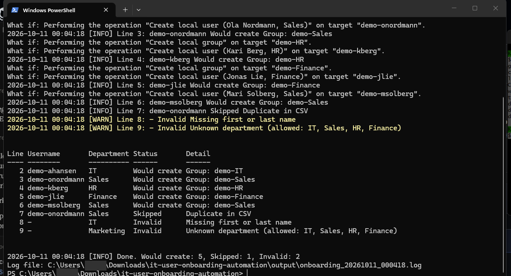
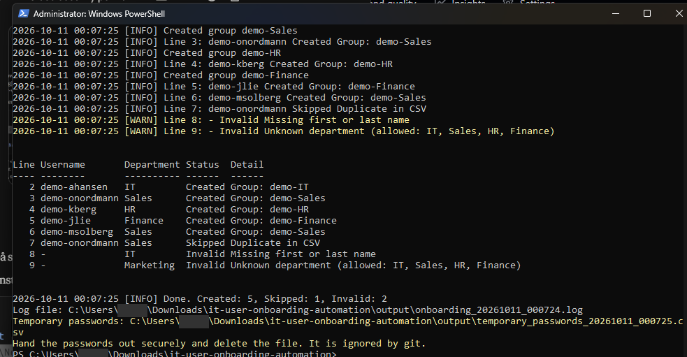
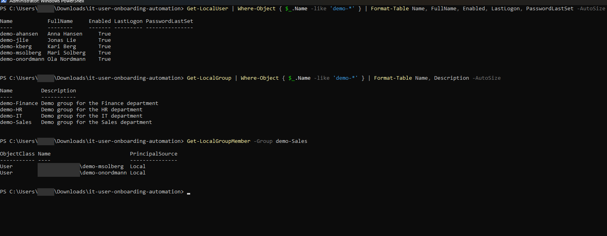
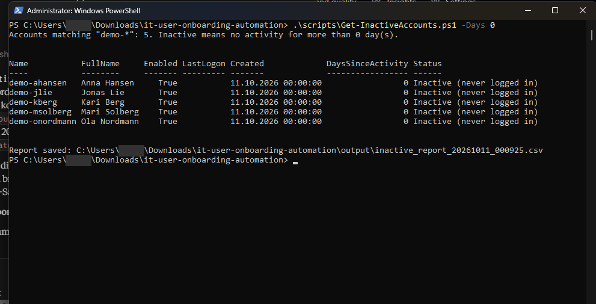
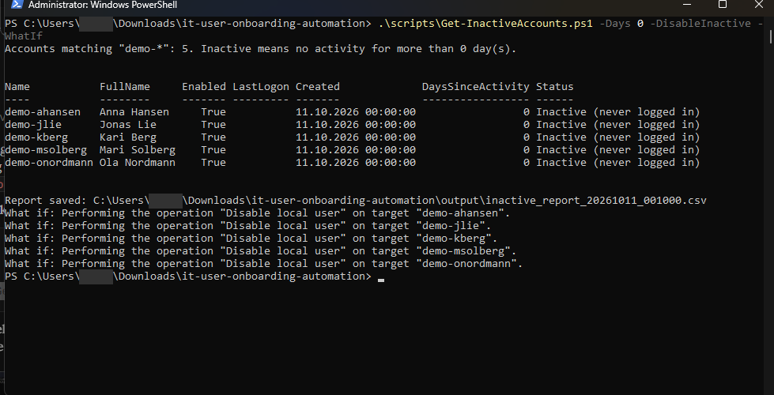
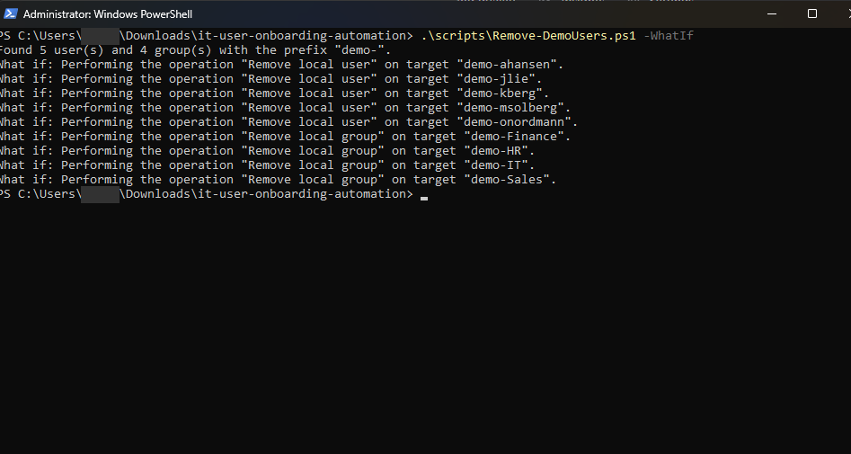
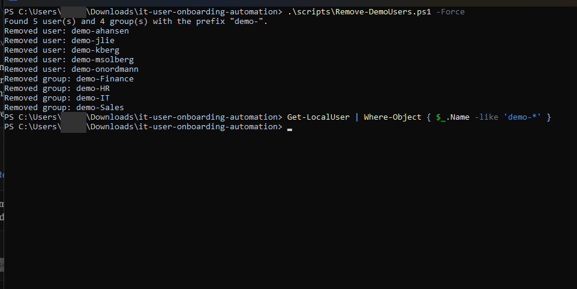

# IT User Onboarding Automation

[](https://github.com/adankhalid0/it-user-onboarding-automation/actions/workflows/ci.yml)

PowerShell tools for the repetitive part of IT support: creating users and groups from a list, finding accounts that are no longer used, and cleaning up afterwards. Everything runs locally on a Windows machine with the built-in local account cmdlets, so there is nothing to install and nothing to pay for.

I built this to practise the day-to-day work of an IT support role in a safe way: onboarding, access through groups, a clear log of what happened, and a dry run before anything is changed.

## What it does

| Script | Purpose |
| --- | --- |
| `scripts/New-UserOnboarding.ps1` | Reads `data/users.csv`, validates every row, creates a local user per valid row and adds the user to a department group. Writes a log and a file with temporary passwords. |
| `scripts/Get-InactiveAccounts.ps1` | Reports accounts with no activity for a number of days. Can disable the inactive ones. |
| `scripts/Remove-DemoUsers.ps1` | Removes all demo users and groups again. |

## Safety

The scripts change real accounts on the machine they run on, so they are built to be careful:

- Everything that is created gets the prefix `demo-` (users such as `demo-ahansen`, groups such as `demo-IT`). Cleanup only touches objects with that prefix.
- `-WhatIf` gives a dry run for every script. It shows what would happen without changing anything.
- A real run needs an elevated PowerShell and stops with a clear message otherwise.
- `Remove-DemoUsers.ps1` refuses prefixes shorter than 5 characters, and `Get-InactiveAccounts.ps1 -DisableInactive` refuses an empty prefix, so they cannot be pointed at real accounts by accident.
- Passwords are generated at runtime (16 characters, cryptographically random), must be changed at first logon, and are written only to the `output/` folder, which is ignored by git. No passwords are stored in the repository.

## Requirements

- Windows 10 or 11
- Windows PowerShell 5.1 or PowerShell 7
- An elevated (administrator) PowerShell for real runs. Dry runs work without.

## Usage

Open PowerShell in the repository folder.

```powershell
# 1. Dry run: see what would happen
.\scripts\New-UserOnboarding.ps1 -WhatIf

# 2. Real run (elevated PowerShell)
.\scripts\New-UserOnboarding.ps1

# 3. Check which accounts are inactive (-Days 0 treats every account that has not logged in as inactive)
.\scripts\Get-InactiveAccounts.ps1 -Days 0

# 4. See which accounts would be disabled, without disabling them
.\scripts\Get-InactiveAccounts.ps1 -Days 0 -DisableInactive -WhatIf

# 5. Clean up the demo accounts again
.\scripts\Remove-DemoUsers.ps1 -Force
```

If PowerShell blocks the scripts, allow them for the current window only:

```powershell
Set-ExecutionPolicy -Scope Process -ExecutionPolicy Bypass
```

## Input format

`data/users.csv` has three columns:

```csv
FirstName,LastName,Department
Anna,Hansen,IT
Ola,Nordmann,Sales
```

Allowed departments are `IT`, `Sales`, `HR` and `Finance`. The sample file also contains a few bad rows on purpose, to show the validation: a duplicate, a missing last name and an unknown department.

## Results

All screenshots are from a real run on my own Windows machine.

**The input file.** `data/users.csv` has five valid users and three rows that should be rejected: a duplicate, a missing last name and an unknown department.


**Dry run.** `-WhatIf` shows what would happen. Nothing is changed, and the bad rows are already flagged.



**Real run.** Five users are created and added to their department groups. The duplicate is skipped and the two invalid rows are reported with the reason.



**Verification.** The users and groups exist, and the members of `demo-Sales` are the two users from the Sales department.



**Inactive account report.** With `-Days 0`, every account that has not logged in is reported as inactive. The report is also saved as a CSV file.



**Disabling inactive accounts, dry run.** `-DisableInactive -WhatIf` lists which accounts would be disabled without touching them.



**Cleanup.** The dry run shows exactly which objects would be removed. The real run removes the five users and four groups, and a check afterwards finds nothing left.





## How it works

- **Validation first.** Every row is checked before anything is created. Rows with a missing name, an unknown department or a username longer than 20 characters (the Windows limit) are marked `Invalid` and skipped. Duplicates in the file and users that already exist are marked `Skipped`.
- **Predictable usernames.** The username is the prefix, the first letter of the first name and the last name, for example `demo-ahansen`. Norwegian letters are converted (`ae`, `o`, `a`) and other characters are removed.
- **One group per department.** Access is given through groups, not per user, which is how it is usually done in a real environment.
- **A log for every run.** Each action is written to a timestamped log file in `output/`, also during a dry run.
- **Exit code.** The onboarding script exits with an error code if any user could not be created. Invalid rows are reported but do not count as errors.

## What I learned

- Dry runs (`-WhatIf`) with `SupportsShouldProcess` make scripts that change systems much safer to test.
- Validating input and reporting each row clearly is more useful than a script that stops at the first problem.
- Scoping everything with a prefix makes automation easy to clean up, and it limits the damage if something goes wrong.
- Local accounts do not store a creation date. For accounts that have never logged in, the report uses the date the password was set. Because the onboarding script forces a password change at first logon, Windows leaves that date empty, so the report falls back to the onboarding date written in the account description. I found this when the first test of the report showed an empty date, and fixed it.
